<a href="https://lofi-studio-one.vercel.app"><picture><source media="(prefers-reduced-motion: reduce)" srcset="docs/media/hero-still.webp"></picture></a>

<h3 align="center">Teach Claude to paint pixel worlds you could stay in for an hour.</h3>

<p align="center">Painted Pixels is a skill for <a href="https://claude.com/claude-code">Claude Code</a>. It's how the worlds in <a href="https://github.com/rader-ai/lofi-studio">Lofi Studio</a> get made: how we think about every element, a toolkit of brushes, creatures and people, and everything that went wrong along the way.</p>

<p align="center"><a href="#get-it"></a>&nbsp;&nbsp;<a href="https://lofi-studio-one.vercel.app"></a></p>

<br>

<h2></h2>

Scenes drawn in code tend to look like painted backdrops with things sliding across them. The idea here is that someone should be able to stay for an hour. So before anything gets painted, the place gets walked:

1. Where's the light, how high is it, and what colour?
2. What's the family of colours, and what's the one accent?
3. What's far, middle, near and very near?
4. What moves, and what moves it?
5. What lives here, and what turns up once in a while?
6. What would someone do here?
7. What's the moment you'd want to catch on screen?

Then the frame gets blocked in with big flat shapes to check where the eye goes. Each element is painted on its own and looked at three ways: up close, in the frame, and at the size it'll be on a phone.

<table>
<tr><th width="50%">Early on</th><th width="50%">Now</th></tr>
<tr><td></td><td></td></tr>
<tr><td></td><td></td></tr>
<tr><td>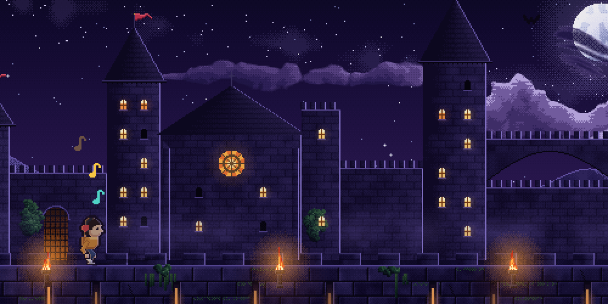</td><td>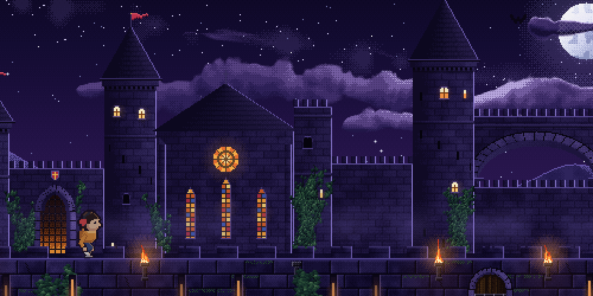</td></tr>
<tr><td></td><td></td></tr>
<tr><td>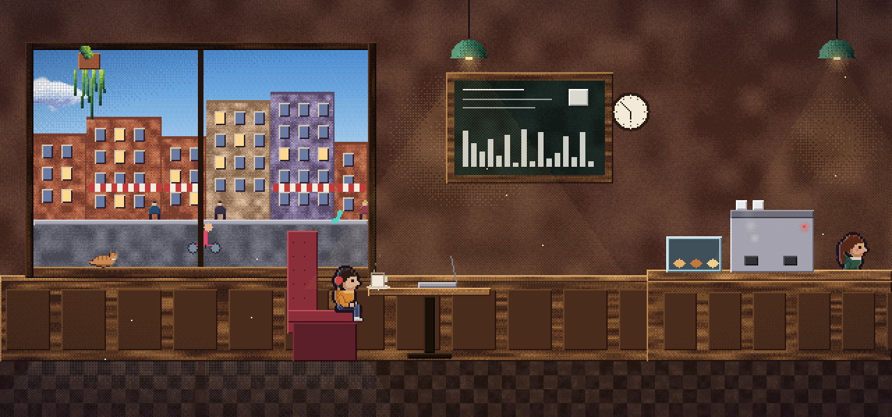</td><td>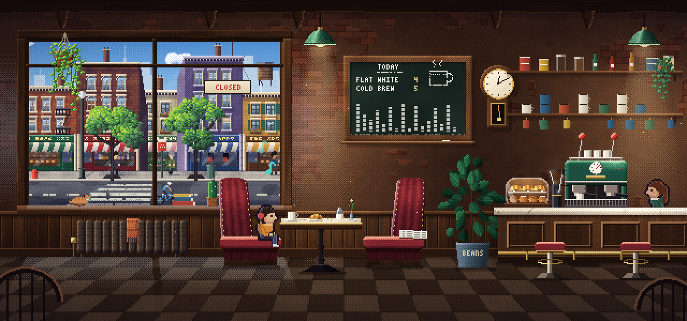</td></tr>
<tr><td>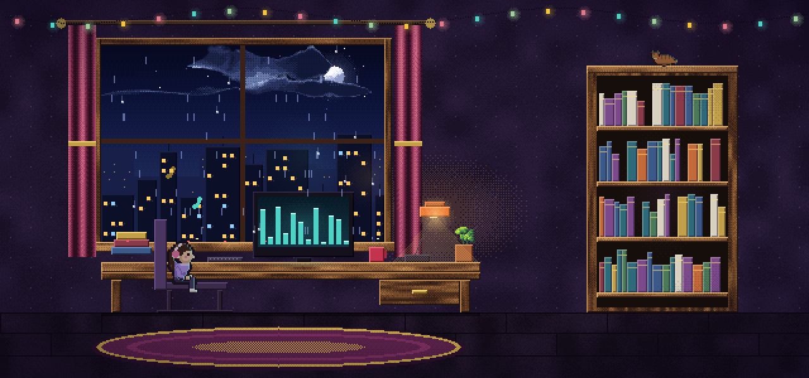</td><td>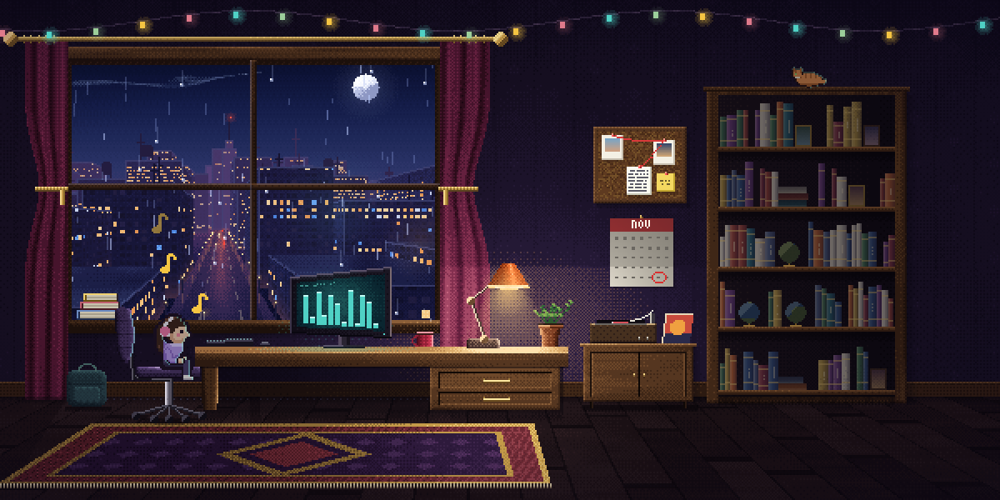</td></tr>
</table>

<br>

<h2></h2>

Light is what makes a scene hold together, and people notice when it's wrong even if they can't say why. So each place writes down where its sun, moon, fires and lamps are, and everything reads from that. Nothing can disagree.

**A moving thing takes the light where it is.** The fox is dark at the edge of the clearing, warms as it reaches the fire, and goes dark again as it leaves. Nobody animated that.

<picture><source media="(prefers-reduced-motion: reduce)" srcset="docs/media/fox-firelight-still.webp"></picture>

**Shadows are cast from each thing's real shape.** They fan out from the point under the sun, so they swing round as you walk past, and a walker's legs scissor in theirs.

<picture><source media="(prefers-reduced-motion: reduce)" srcset="docs/media/beach-shadows-still.webp"></picture>

<table>
<tr>
<td width="50%" valign="top"><picture><source media="(prefers-reduced-motion: reduce)" srcset="docs/media/cloud-sun-still.webp"></picture><br><b>Whatever blocks the light takes it away.</b> A cloud over the sun dims the whole park, and shadows fade until it passes. Four times real speed.</td>
<td width="50%" valign="top"><picture><source media="(prefers-reduced-motion: reduce)" srcset="docs/media/torch-walker-still.webp"></picture><br><b>People take two lights.</b> The walker is warmed by each torch they pass, and the moon stays on the other shoulder.</td>
</tr>
</table>

The guide covers the rest: what reflects, what lets light through, what the air does to it, and how to check a scene one thing at a time.

<br>

<h2></h2>

Anything that changes over time has to be built so that it really can. A beautifully painted cloud that can't change is still wrong.

<table>
<tr>
<td width="50%" valign="top"><picture><source media="(prefers-reduced-motion: reduce)" srcset="docs/media/clouds-night-still.webp"></picture></td>
<td width="50%" valign="top"><picture><source media="(prefers-reduced-motion: reduce)" srcset="docs/media/clouds-day-still.webp"></picture></td>
</tr>
<tr><td colspan="2"><b>Clouds gather, change and dissolve,</b> each one lit from wherever the sun or moon really hangs. Eight times real speed.</td></tr>
<tr>
<td width="50%" valign="top"><picture><source media="(prefers-reduced-motion: reduce)" srcset="docs/media/surf-still.webp"></picture><br><b>A wave has a whole life.</b> A crest stands up, a sheet rushes in, froth breaks into lace, and it leaves the sand dark and wet.</td>
<td width="50%" valign="top"><picture><source media="(prefers-reduced-motion: reduce)" srcset="docs/media/whale-still.webp"></picture><br><b>Rare is rare.</b> Sights come one at a time from a shuffled bag, so seeing one feels like luck.</td>
</tr>
</table>

<br>

<h2></h2>

A person feels alive through small human moments. They wink at you, yawn, sneeze, and push a hand through their hair. Nobody bobs to the beat, and a foot on the ground never slides.

<table>
<tr>
<td width="33%" align="center"><picture><source media="(prefers-reduced-motion: reduce)" srcset="docs/media/wink-still.webp"></picture><br>A wink</td>
<td width="33%" align="center"><picture><source media="(prefers-reduced-motion: reduce)" srcset="docs/media/yawn-still.webp"></picture><br>A yawn</td>
<td width="33%" align="center"><picture><source media="(prefers-reduced-motion: reduce)" srcset="docs/media/sneeze-still.webp"></picture><br>A sneeze</td>
</tr>
<tr>
<td align="center"><picture><source media="(prefers-reduced-motion: reduce)" srcset="docs/media/hair-still.webp"></picture><br>A hand through the hair</td>
<td align="center"><picture><source media="(prefers-reduced-motion: reduce)" srcset="docs/media/stretch-still.webp"></picture><br>A stretch</td>
<td align="center"><picture><source media="(prefers-reduced-motion: reduce)" srcset="docs/media/cough-still.webp"></picture><br>A cough</td>
</tr>
</table>

And each place gives them something to do.

<table>
<tr>
<td width="50%" valign="top"><picture><source media="(prefers-reduced-motion: reduce)" srcset="docs/media/marshmallow-still.webp"></picture><br>At the campfire, the marshmallow catches. They wave it, blow it out, shrug, and eat it anyway.</td>
<td width="50%" valign="top"><picture><source media="(prefers-reduced-motion: reduce)" srcset="docs/media/fishing-still.webp">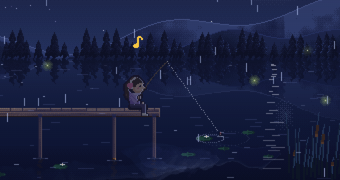</picture><br>On the dock in the rain, something finally takes the bait.</td>
</tr>
</table>

<br>

<h2>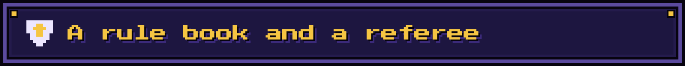</h2>

The style is written down, so nobody has to guess at it. [The style guide](references/style.md) says what it is and isn't, with the real numbers from all eight worlds. [The rule book](references/rules.md) has 45 rules. A **Law** can't be broken. A **Custom** can, if you say which one and why.

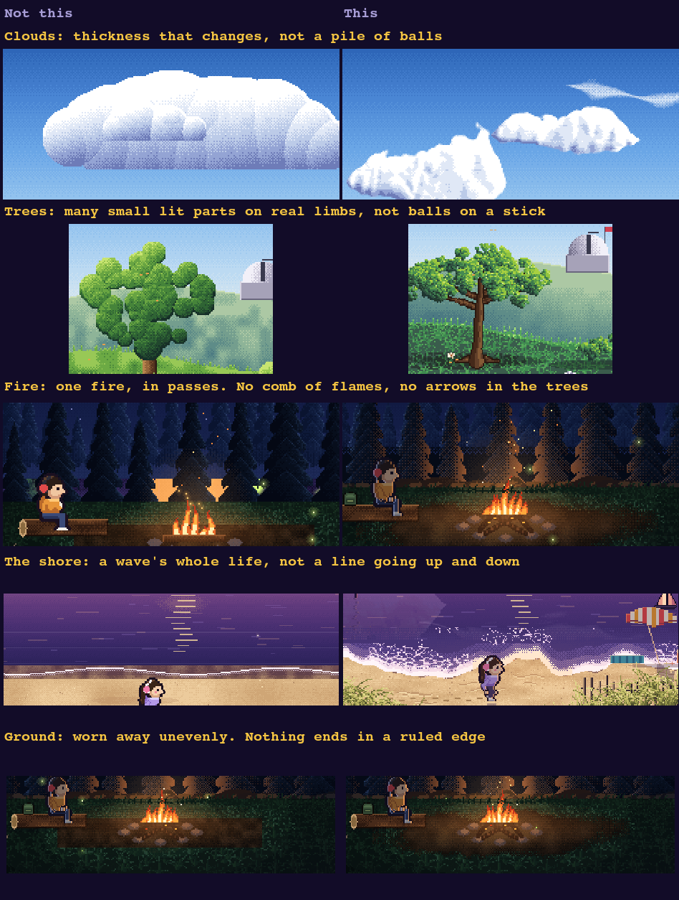

Then **a referee** checks the work. `scripts/validate.mjs` runs the scene in a muted browser, on a clock it steps by hand, and measures whatever can be measured: whether anything's blurred, whether the colours shift along their ramps, whether the person bounces to the beat, whether something appears out of nowhere, whether every rare sight ends by itself, and whether a cache grows until the page goes blank. That's 28 of the rules. The other 17 take judgement, like whether every bright side faces the moon, so it hands those back as a list to walk, with a sheet of what to look at. Rank S takes both.

The forest on the day it got a scene of its own, and the forest now:

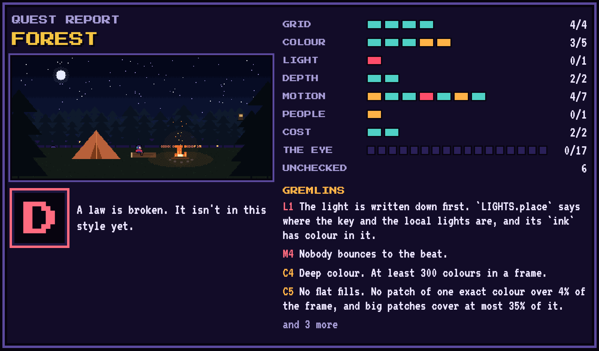

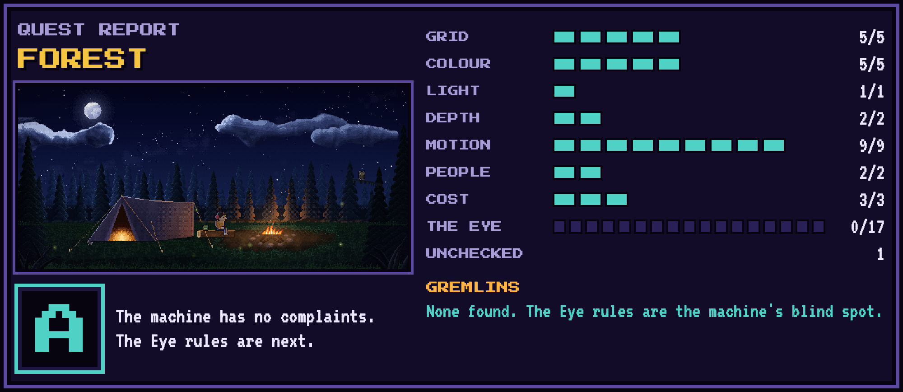

**The limits come from our own history.** Every old version of Lofi Studio still runs, so the referee was pointed at each one. What people complained about mostly fails, and what's there now passes.

| What people said | What the referee finds in that version |
|---|---|
| "i was hoping for this style vs our traditional pixels" | 41 to 87 colours in a frame, and flat patches over as much as 93% of it |
| "the character bounces a lot in every scene" | A beat moves up to 418 pixels around them, in most of the worlds |
| "i was hoping for subtle motion and feeling of being alive" | Nobody's on a life clock, in any world |
| "the lights turning off and on in the castle seem too fast" | A beat changes 3.5% of the castle |
| "I'm big on the lighting too" | The light isn't written down anywhere |
| "Everything is ugly squares", of the coffee shop | 10.3% of the frame was plain boxes, and 2.2% once it was repainted. That check exists because of that sentence |
| "the rain in the office is appearing inside and in front of the TV" | Nothing. It takes someone looking, and that's what the Eye rules are for |
| "the trees just look like balls" | Nothing, for the same reason |

The [whole table](references/validation.md#why-these-numbers) is in the guide.

It found bugs that had shipped, too. A fishing rod at fractions of a pixel. Lamps in the coffee shop pulsing with the beat. Someone who kept walking for people who'd asked for less motion. A black cat that could stay on the castle wall for minutes. And when it caught clouds appearing from nothing, on an old version, it saved the frame before and the frame after:

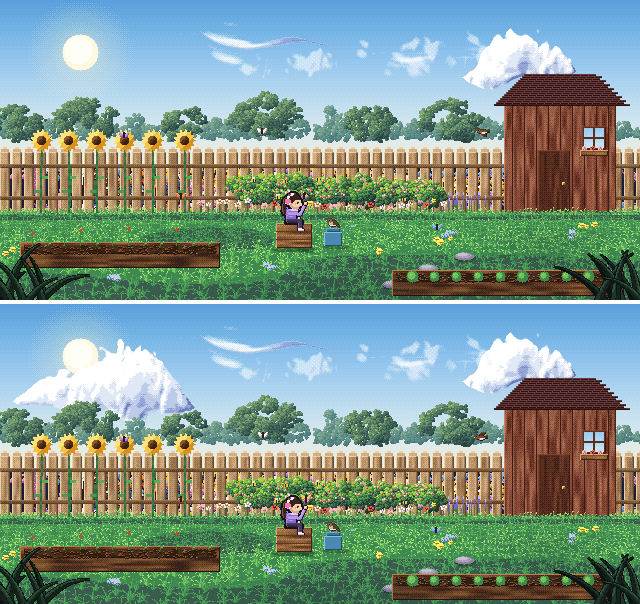

**It can't tell you a scene is beautiful.** A rank is a floor, not a compliment. All eight worlds had Rank A on the day someone looked at two of them and saw rain falling through a TV, a bus driving through a booth, and "everything is ugly squares". The repaint you can see above came from that sentence, and the rule that would have caught the rain was sitting there unticked, waiting for someone to look. [What it can't see](references/validation.md#what-it-cant-see) is written down too, and every check has [a page made to break it](scripts/fixtures), so that the referee gets checked as well.

**And it talks like a party member.** While Claude's using this skill, it sounds like a small, cheerful companion at a 16-bit inn. It's seasoning: numbers, commands and anything you have to decide stay in plain words, it reports just as honestly, and it [drops the voice](references/voice.md) if something's really wrong or you ask it to.

> ▶ Quest complete: your rooftop garden is finished. Rank S: 27 of 27 machine checks clear, and I walked all 17 Eye rules with a note on each. Rank is a floor, not a compliment: it means nothing was found and somebody looked, not that it's beautiful.
>
> **Still in the fog:** how the motion feels (I judged it from strips, so the cat's and plane's pace, the window on/off rate and the string's sway are the likeliest to need tuning); real phones and Safari (Chrome emulation only).

That's a real report, from the test below.

<br>

<h2 id="get-it"></h2>

**In Claude Code,** add it as a plugin, then start a new session:

```
/plugin marketplace add rader-ai/painted-pixels
/plugin install painted-pixels@painted-pixels
```

**By hand,** clone it into your skills folder. That's where Claude Code looks, and another agent that reads skills will have a folder of its own:

```bash
git clone https://github.com/rader-ai/painted-pixels ~/.claude/skills/painted-pixels
```

To look at your art up close and to run the referee, the tools need Node and Chrome. Run `npm install` once in the skill's `scripts/` folder, and everything runs muted.

You don't need Claude to use any of this. Open [`assets/starter.html`](assets/starter.html) in a browser, read the guides, and paint by hand. It's a small complete world, and [`assets/kit.js`](assets/kit.js) is the whole toolkit in one file, with no dependencies.

<br>

<h2></h2>

Describe what you want, and Claude picks the skill up by itself. To call it by name, type `/painted-pixels`, or `/painted-pixels:painted-pixels` if you installed the plugin.

- *Paint a rooftop garden in a big city at night for the top of my site*
- *My lake feels static. What's wrong with it?*
- *The way my cat walks looks stiff*
- *Add a lighthouse on a headland, and something that happens there now and then*
- *This character looks pasted on*
- *Check my scene against the rule book*

To test it, a fresh Claude got that first request and nothing else but this skill. This is [its rooftop garden](assets/examples/rooftop): its own city, its own moths and its own cat on the wall, on top of the kit. It got Rank S, and it still said that the person is small, and "if you change one thing, make him bigger".

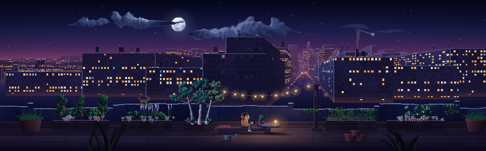

And [a snowy cabin at dusk](assets/examples/cabin.html), with its own snow and mountains. Download either one and open it to see it move.


<br>

<h2></h2>

Claude reads these as it needs them, and they're written so that you can read them too.

| Element | The short version | Guide |
|---|---|---|
| **The style** | What it is and isn't on one page, with the real numbers from all eight worlds | [style](references/style.md) |
| **The rule book** | 45 rules, each a Law or a Custom, checked by machine or by eye | [rules](references/rules.md) |
| **The referee** | How to run it, what the ranks mean, and what it can't see | [validation](references/validation.md) |
| How we talk | A small, cheerful party member at a 16-bit inn. Facts stay plain | [voice](references/voice.md) |
| The look | Decide where the eye goes first. Hue-shifted ramps, ordered dither, no blur, outlines only where they earn it | [look](references/look.md) |
| **Light** | What we care about most. Where it comes from, how it really behaves, what reflects it, and what it does to whatever's moving through it | [light](references/light.md) |
| Sky | One gradient, stars that each twinkle, a moon that lights things, clouds that gather, change and dissolve | [sky](references/sky.md) |
| Plants and ground | Lots of small parts that each catch the light: leaves, blades, petals, and a tree that comes from one source | [plants and ground](references/plants-and-ground.md) |
| Water | Whatever's above it, moved around. A wave has a whole life, from crest to wet sand | [water](references/water.md) |
| Built things | Regular shapes that time has got at. Rooms get a light plan. Fire is one fire | [built things](references/built-things.md) |
| Depth and motion | Depth sets speed. One wind for everything. Still until something moves it. Nothing bounces to the beat | [depth and motion](references/depth-and-motion.md) |
| People | Alive through small human moments. Feet that never slide | [people](references/people.md) |
| Creatures | Everything has a reason, the world notices itself, and rare is rare | [creatures](references/creatures.md) |
| Checking | Three kinds of looking, and being honest about what you couldn't see | [checking](references/checking.md) |
| Mistakes | Each thing that's gone wrong, in the words of whoever spotted it | [mistakes](references/mistakes.md) |
| The eight worlds | Each one as a worked example, and how to add another | [worlds](references/worlds.md) |

```
SKILL.md              where Claude starts
references/           a guide to each element, and an index of the kit
assets/kit.js         the whole painting toolkit in one file
assets/starter.html   a small complete world to copy
assets/examples/      two whole scenes for a web page, made with this skill
assets/gallery/       real crops from the app, then and now
assets/dress.css      the panels, buttons and stat bars that go around a scene
assets/fonts/         Press Start 2P and VT323, for that dress
scripts/look.mjs      looks at any page up close, on a clock you can step
scripts/validate.mjs  the referee: checks a scene against the rule book
scripts/fixtures/     a page made to break each rule, so the referee gets checked too
docs/                 the pictures on this page, and the scripts that record them
```

The kit and the pictures are copied from Lofi Studio's [`index.html`](https://github.com/rader-ai/lofi-studio/blob/main/index.html), and every moving picture here is a real recording of it. [`checking.md`](references/checking.md) has the commands that rebuild them.

<br>

<p align="center"><sub>Made by <a href="https://happyrader.com">Chris Rader</a> (<a href="https://github.com/rader-ai">@rader-ai</a>) with Claude. The fonts are Press Start 2P and VT323 (SIL Open Font License).<br><a href="LICENSE">MIT license</a>: change it, ship it, even sell it. Just keep the <code>LICENSE</code> file with your copy.</sub></p>
