<a href="https://lofi-studio-one.vercel.app"><picture><source media="(prefers-reduced-motion: reduce)" srcset="docs/media/hero-still.webp">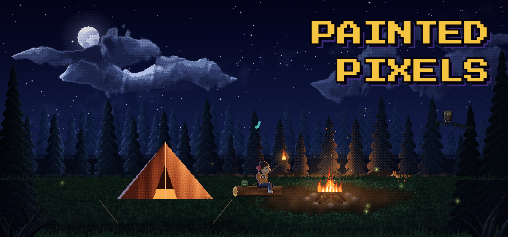</picture></a>

<h3 align="center">Teach Claude to paint pixel worlds you could stay in for an hour.</h3>

<p align="center">Painted Pixels is a skill for <a href="https://claude.com/claude-code">Claude Code</a>. It's how the worlds in <a href="https://github.com/rader-ai/lofi-studio">Lofi Studio</a> get made: how we think about every element, a toolkit of brushes, creatures and people, and everything that went wrong along the way.</p>

<p align="center"><a href="#get-it"></a>&nbsp;&nbsp;<a href="https://lofi-studio-one.vercel.app">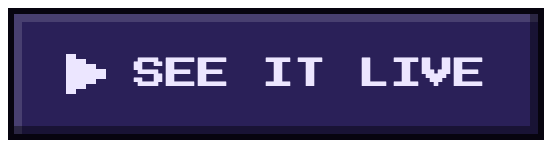</a></p>

<br>

<h2>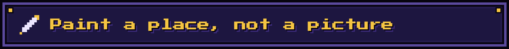</h2>

Scenes drawn in code tend to look like painted backdrops with things sliding across them. The idea here is that someone should be able to stay for an hour. So before anything gets painted, the place gets walked:

1. Where's the light, how high is it, and what colour?
2. What's the family of colours, and what's the one accent?
3. What's far, middle, near and very near?
4. What moves, and what moves it?
5. What lives here, and what turns up once in a while?
6. What would someone do here?
7. What's the moment you'd want to catch on screen?

Then the frame gets blocked in with big flat shapes to check where the eye goes. Each element is painted on its own and looked at three ways: up close, in the frame, and at the size it'll be on a phone.

<table>
<tr><th width="50%">Early on</th><th width="50%">Now</th></tr>
<tr><td>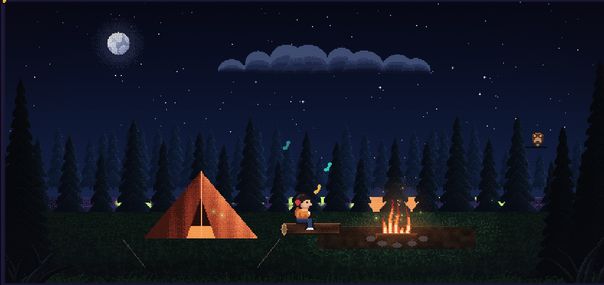</td><td>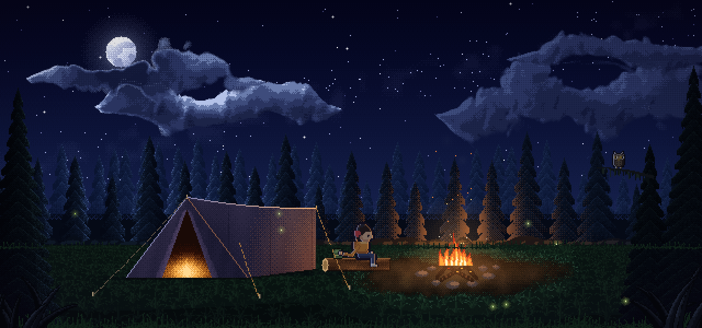</td></tr>
<tr><td>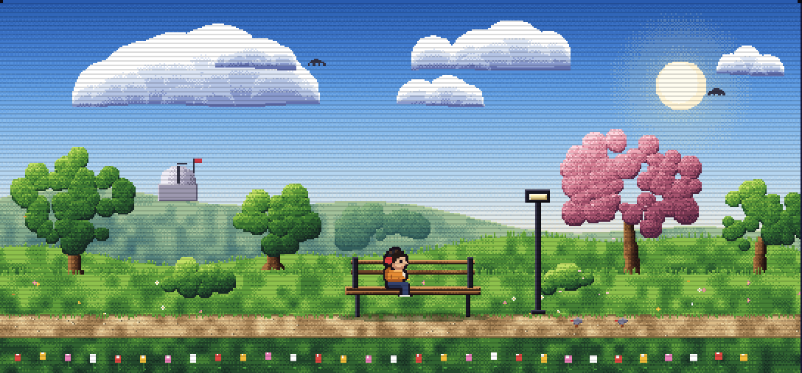</td><td>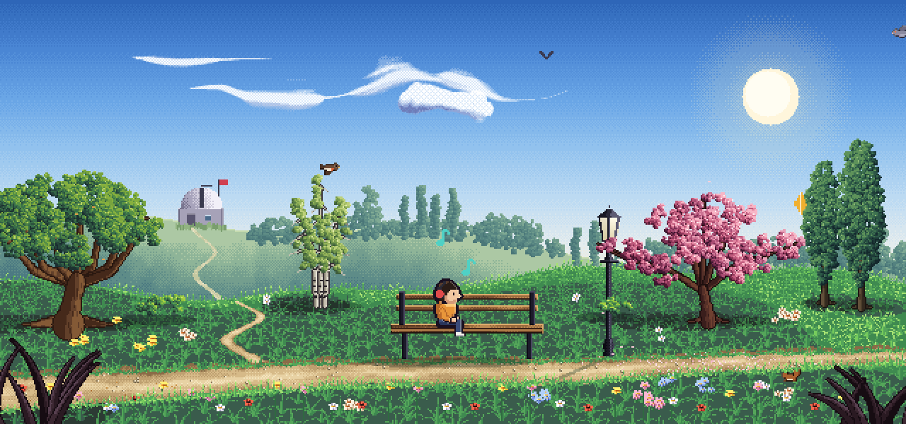</td></tr>
<tr><td>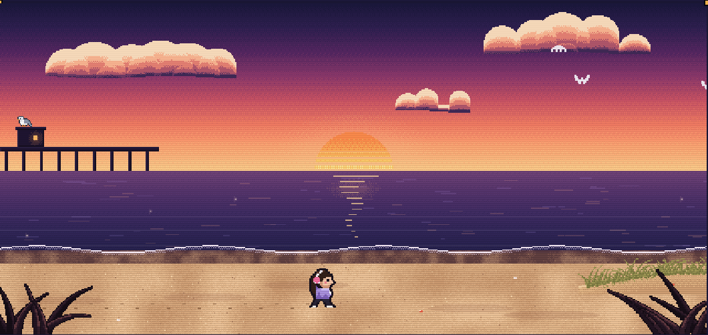</td><td>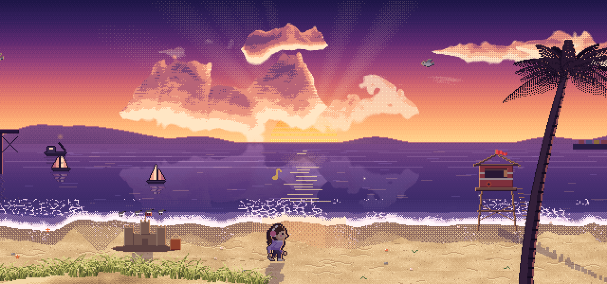</td></tr>
</table>

<br>

<h2>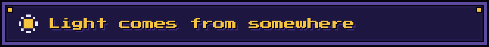</h2>

Light is what makes a scene hold together, and people notice when it's wrong even if they can't say why. So each place writes down where its sun, moon, fires and lamps are, and everything reads from that. Nothing can disagree.

**A moving thing takes the light where it is.** The fox is dark at the edge of the clearing, warms as it reaches the fire, and goes dark again as it leaves. Nobody animated that.

<picture><source media="(prefers-reduced-motion: reduce)" srcset="docs/media/fox-firelight-still.webp">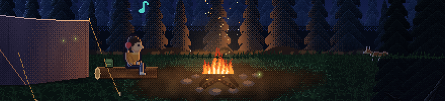</picture>

**Shadows are cast from each thing's real shape.** They fan out from the point under the sun, so they swing round as you walk past, and a walker's legs scissor in theirs.

<picture><source media="(prefers-reduced-motion: reduce)" srcset="docs/media/beach-shadows-still.webp">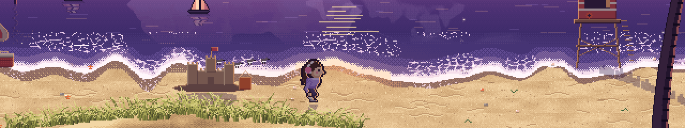</picture>

<table>
<tr>
<td width="50%" valign="top"><picture><source media="(prefers-reduced-motion: reduce)" srcset="docs/media/cloud-sun-still.webp">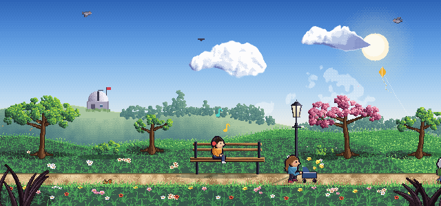</picture><br><b>Whatever blocks the light takes it away.</b> A cloud over the sun dims the whole park, and shadows fade until it passes. Four times real speed.</td>
<td width="50%" valign="top"><picture><source media="(prefers-reduced-motion: reduce)" srcset="docs/media/torch-walker-still.webp">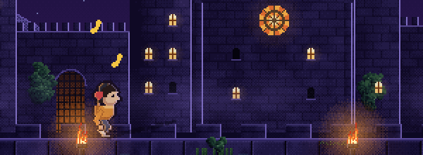</picture><br><b>People take two lights.</b> The walker is warmed by each torch they pass, and the moon stays on the other shoulder.</td>
</tr>
</table>

The guide covers the rest: what reflects, what lets light through, what the air does to it, and how to check a scene one thing at a time.

<br>

<h2>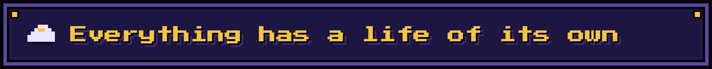</h2>

Anything that changes over time has to be built so that it really can. A beautifully painted cloud that can't change is still wrong.

<table>
<tr>
<td width="50%" valign="top"><picture><source media="(prefers-reduced-motion: reduce)" srcset="docs/media/clouds-night-still.webp">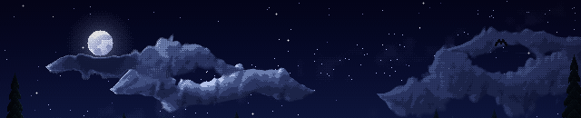</picture></td>
<td width="50%" valign="top"><picture><source media="(prefers-reduced-motion: reduce)" srcset="docs/media/clouds-day-still.webp">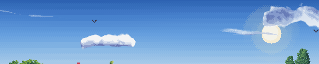</picture></td>
</tr>
<tr><td colspan="2"><b>Clouds gather, change and dissolve,</b> each one lit from wherever the sun or moon really hangs. Eight times real speed.</td></tr>
<tr>
<td width="50%" valign="top"><picture><source media="(prefers-reduced-motion: reduce)" srcset="docs/media/surf-still.webp">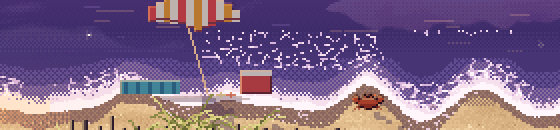</picture><br><b>A wave has a whole life.</b> A crest stands up, a sheet rushes in, froth breaks into lace, and it leaves the sand dark and wet.</td>
<td width="50%" valign="top"><picture><source media="(prefers-reduced-motion: reduce)" srcset="docs/media/whale-still.webp">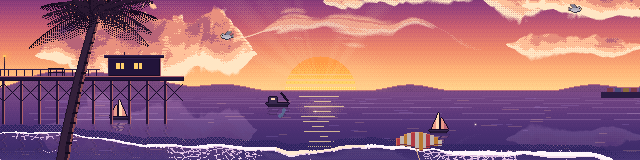</picture><br><b>Rare is rare.</b> Sights come one at a time from a shuffled bag, so seeing one feels like luck.</td>
</tr>
</table>

<br>

<h2>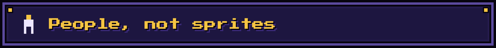</h2>

A person feels alive through small human moments. They wink at you, yawn, sneeze, and push a hand through their hair. Nobody bobs to the beat, and a foot on the ground never slides.

<table>
<tr>
<td width="33%" align="center"><picture><source media="(prefers-reduced-motion: reduce)" srcset="docs/media/wink-still.webp">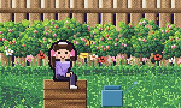</picture><br>A wink</td>
<td width="33%" align="center"><picture><source media="(prefers-reduced-motion: reduce)" srcset="docs/media/yawn-still.webp">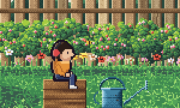</picture><br>A yawn</td>
<td width="33%" align="center"><picture><source media="(prefers-reduced-motion: reduce)" srcset="docs/media/sneeze-still.webp">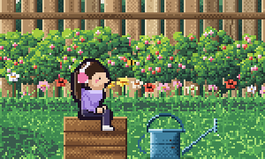</picture><br>A sneeze</td>
</tr>
<tr>
<td align="center"><picture><source media="(prefers-reduced-motion: reduce)" srcset="docs/media/hair-still.webp">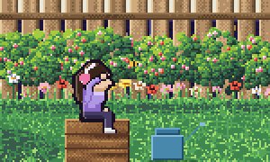</picture><br>A hand through the hair</td>
<td align="center"><picture><source media="(prefers-reduced-motion: reduce)" srcset="docs/media/stretch-still.webp">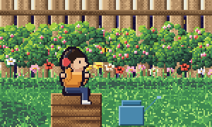</picture><br>A stretch</td>
<td align="center"><picture><source media="(prefers-reduced-motion: reduce)" srcset="docs/media/cough-still.webp">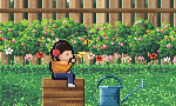</picture><br>A cough</td>
</tr>
</table>

And each place gives them something to do. At the campfire, the marshmallow catches. They wave it, blow it out, shrug, and eat it anyway.

<picture><source media="(prefers-reduced-motion: reduce)" srcset="docs/media/marshmallow-still.webp">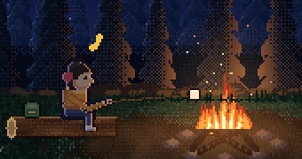</picture>

<br>

<h2 id="get-it">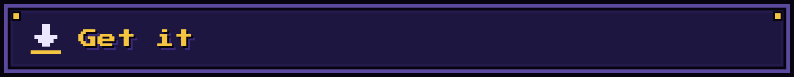</h2>

**In Claude Code,** add it as a plugin, then start a new session:

```
/plugin marketplace add rader-ai/painted-pixels
/plugin install painted-pixels@painted-pixels
```

**By hand,** clone it into your skills folder. That's where Claude Code looks, and another agent that reads skills will have a folder of its own:

```bash
git clone https://github.com/rader-ai/painted-pixels ~/.claude/skills/painted-pixels
```

To look at your art up close, the tools need Node and Chrome. Run `npm install` once in the skill's `scripts/` folder, and everything runs muted.

You don't need Claude to use any of this. Open [`assets/starter.html`](assets/starter.html) in a browser, read the guides, and paint by hand. It's a small complete world, and [`assets/kit.js`](assets/kit.js) is the whole toolkit in one file, with no dependencies.

<br>

<h2>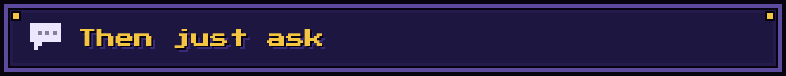</h2>

Describe what you want, and Claude picks the skill up by itself. To call it by name, type `/painted-pixels`, or `/painted-pixels:painted-pixels` if you installed the plugin.

- *Paint a rooftop garden in a big city at night for the top of my site*
- *My lake feels static. What's wrong with it?*
- *The way my cat walks looks stiff*
- *Add a lighthouse on a headland, and something that happens there now and then*
- *This character looks pasted on*

Here's one it made outside the app, as a test: [a snowy cabin at dusk](assets/examples/cabin.html), with its own snow and mountains painted on top of the kit. Download the file and open it to see it move.

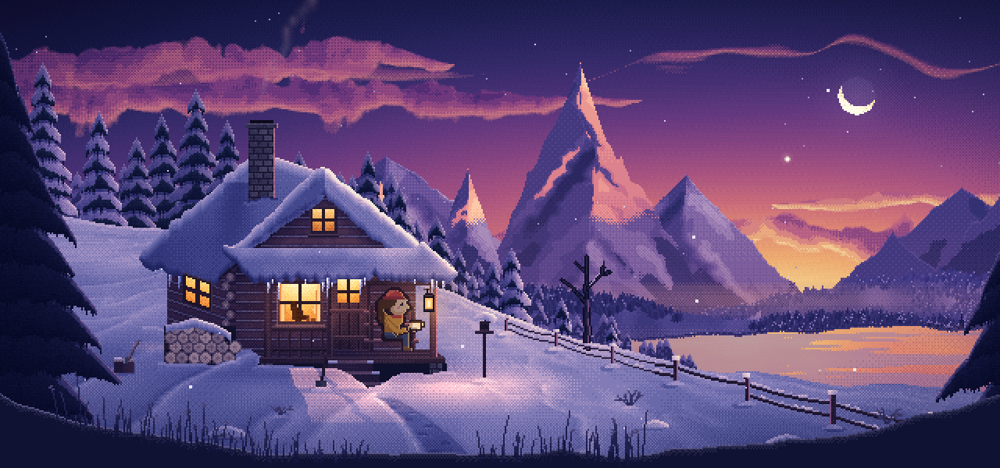

<br>

<h2>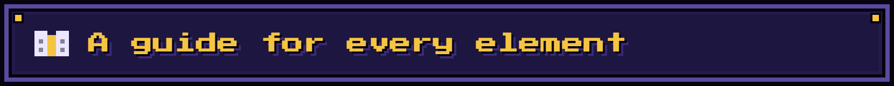</h2>

Claude reads these as it needs them, and they're written so that you can read them too.

| Element | The short version | Guide |
|---|---|---|
| The look | Decide where the eye goes first. Hue-shifted ramps, ordered dither, no blur, outlines only where they earn it | [look](references/look.md) |
| **Light** | What we care about most. Where it comes from, how it really behaves, what reflects it, and what it does to whatever's moving through it | [light](references/light.md) |
| Sky | One gradient, stars that each twinkle, a moon that lights things, clouds that gather, change and dissolve | [sky](references/sky.md) |
| Plants and ground | Lots of small parts that each catch the light: leaves, blades, petals, and a tree that comes from one source | [plants and ground](references/plants-and-ground.md) |
| Water | Whatever's above it, moved around. A wave has a whole life, from crest to wet sand | [water](references/water.md) |
| Built things | Regular shapes that time has got at. Rooms get a light plan. Fire is one fire | [built things](references/built-things.md) |
| Depth and motion | Depth sets speed. One wind for everything. Still until something moves it. Nothing bounces to the beat | [depth and motion](references/depth-and-motion.md) |
| People | Alive through small human moments. Feet that never slide | [people](references/people.md) |
| Creatures | Everything has a reason, the world notices itself, and rare is rare | [creatures](references/creatures.md) |
| Checking | Three kinds of looking, and being honest about what you couldn't see | [checking](references/checking.md) |
| Mistakes | Each thing that's gone wrong, in the words of whoever spotted it | [mistakes](references/mistakes.md) |
| The eight worlds | Each one as a worked example, and how to add another | [worlds](references/worlds.md) |

```
SKILL.md              where Claude starts
references/           a guide to each element, and an index of the kit
assets/kit.js         the whole painting toolkit in one file
assets/starter.html   a small complete world to copy
assets/examples/      a whole scene for a web page, made with this skill
assets/gallery/       real crops from the app: what good looks like, and what it used to look like
scripts/look.mjs      looks at any page up close, on a clock you can step
docs/                 the pictures on this page, and the scripts that record them
```

The kit and the pictures are copied from Lofi Studio's [`index.html`](https://github.com/rader-ai/lofi-studio/blob/main/index.html), and every moving picture here is a real recording of it. [`checking.md`](references/checking.md) has the commands that rebuild them.

<br>

<p align="center"><sub>Made by <a href="https://happyrader.com">Chris Rader</a> (<a href="https://github.com/rader-ai">@rader-ai</a>) with Claude. The title font is Press Start 2P (SIL Open Font License).<br><a href="LICENSE">MIT license</a>: change it, ship it, even sell it. Just keep the <code>LICENSE</code> file with your copy.</sub></p>
